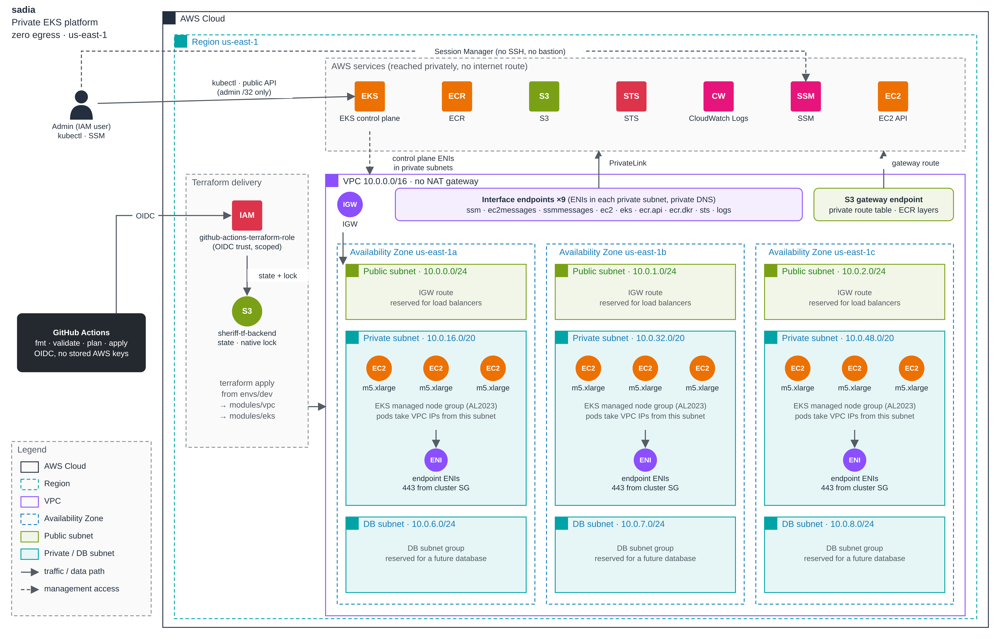

# sadia

A private EKS platform on AWS, built with Terraform.

No NAT gateway and no internet route from the private subnets. Everything reaches AWS through VPC endpoints.



## Layout

```
sadia/
├── envs/dev/        # backend, provider, tfvars, module calls
└── modules/
    ├── vpc/         # network, endpoints, security groups
    └── eks/         # cluster, node groups, IAM, access
```

## Reusable by design

Defaults live in modules, decisions live in the environment. Modules have no provider or backend config, and every setting (names, CIDRs, AZs, version, node groups, admin) is a variable. Going from 2 × t3.medium to 9 × m5.xlarge was a tfvars change only, and node groups are a map, so adding a group is a tfvars entry too. The region is set once, on the provider, and both modules read it from there.

A new environment is a copy of `envs/dev` with its own state key and tfvars.

## Design decisions

**No NAT gateway. AWS access only through VPC endpoints.**
Why: with no route to the internet there's no path for data to leave, and a compromised pod can't call out to an attacker. It also removes NAT's per-GB processing charge.
Trade-off: every image has to come from ECR, and each AWS service needs its own endpoint (billed per AZ per hour).

**Modules hold logic, environments hold values.**
Why: the same modules deploy dev, staging or prod. Changing an environment is a tfvars edit, not a code change, and module changes get reviewed once for every environment.
Trade-off: a setting has to be declared in the environment and passed through `main.tf` before tfvars can control it.

**Modules connect only through outputs, and dependencies run one way (VPC → EKS).**
Why: the VPC module doesn't know EKS exists, so it can host anything. EKS opens its own rule on the endpoints SG instead of feeding its SG back into the VPC module, which keeps the graph one-directional and avoids a duplicate rule.

**Each module creates security groups only for what it owns.**
Why: the VPC module owns the endpoints, so it owns their security group. The EKS module opens its own access to them. Workloads bring their own security groups. Nothing ships unused permissions, and zero egress is enforced by routing, so a loose security group can't open a path to the internet.

**Explicit cluster access, bootstrap admin off.**
Why: access is the same whether `apply` runs from a laptop or from CI. Nobody gets a hidden admin entry just for running Terraform, and the CI role never needs Kubernetes access.
Trade-off: if no admin is declared, nobody can get in. That's why the env requires `admin_principal_arn`.

**S3 backend with native locking (`use_lockfile`).**
Why: Terraform 1.10 locks in S3 itself, so there's no DynamoDB table to create, pay for or manage.

**Plan on the PR, apply on merge, behind an approval.**
Why: the PR shows the plan and a Trivy scan before anything is merged. Merging starts the deploy, but it waits in the `dev` GitHub environment until I approve it, and only `main` can deploy there. Destroy goes through the same approval on top of typing `yes`. CI reaches AWS through OIDC, so there are no stored access keys.
Trade-off: you approve before the deploy's own plan runs, so you're trusting the plan you reviewed on the PR. Splitting plan and apply into two jobs would fix that, but it means passing the plan file as an artifact, and on a public repo anyone could download it with my IP inside.

**Two CI roles, each trusting exactly one kind of job.**
Why: a PR plan only needs to read, so it gets a read-only role (plus the state lock file) that trusts only `pull_request` tokens. Deploy and destroy use the apply role, which trusts only jobs in the `dev` environment. That makes the approval gate something AWS enforces, not just a line in YAML: a job that skips the environment can't get credentials at all. Both trust policies match the full subject exactly, including GitHub's immutable owner and repo IDs, so a recycled or lookalike account name can't match.
Trade-off: the apply role still has broad permissions. Scoping it down to what Terraform actually touches is a later step.

**Admin IPs masked in CI logs.**
Why: GitHub only hides a secret when its exact value appears in the log. `ADMIN_CIDRS` is a list, but plan and Trivy print the bare IP, so it showed up in public logs. Each workflow now pulls the IPs out of the secret and masks them before anything runs.

**Trivy action pinned to a commit SHA, not a tag.**
Why: in March 2026, attackers moved most of `trivy-action`'s version tags to malicious commits that stole CI secrets. A tag can be moved, but a SHA can't, so the code that runs is the code I checked.

**Lock file committed. tfvars split into shared and private.**
Why: the lock file pins the exact provider build, so every machine and CI run gets the same one. `terraform.tfvars` holds the non-sensitive values and is committed, so local and CI read one copy and can't drift. My IP and admin ARN live in a gitignored `secrets.auto.tfvars` locally and in GitHub secrets/variables for CI.

## What I did

- Split a flat project into `modules/vpc`, `modules/eks` and `envs/dev`
- Moved EKS outputs out of the VPC module, and moved the EC2 IAM role and AMI lookup out of it too
- Switched endpoint client SGs to a map so `for_each` works with SGs created in the same apply
- EKS module opens its own 443 rule on the endpoints SG (required, no `count`)
- Renamed `ssm_services` → `interface_endpoints_services`
- Fixed subnet offsets (sized for 6 AZs) so adding an AZ never replaces subnets, and private subnets moved from /24 to /20 for pod IPs
- Raised the provider floor to `>= 5.40` (access entries)
- Bootstrap admin off, admin granted explicitly through `admin_principal_arn`
- Kept SSM on nodes, the only way in when a node won't join
- Lock file committed, `terraform.tfvars` committed with non-sensitive values only, IP and ARN in a gitignored `secrets.auto.tfvars` (GitHub secrets in CI)
- Ran tfsec, first apply locally, then scaled dev to 9 × m5.xlarge (min 9, max 12)
- Node groups turned into a map (`node_groups`), so callers can define any number of groups in tfvars
- IAM role names include the region, so the same project can deploy to a second region without name collisions
- Both modules read the region from the provider instead of taking an `aws_region` input
- Removed the leftover EC2-tier security groups (ALB, app, DB) from the VPC module. It now creates only the endpoints security group, locks down the VPC's default security group, and leaves workload security groups to the workloads
- Added a plan workflow on PRs: fmt check, validate, plan, and a Trivy scan of the plan JSON (report only until the KMS findings are fixed)
- Fixed the destroy workflow (`TF_INPUT` typo, action versions)
- Work happens on a `dev` branch. `main` only changes through a PR
- Found my IP printed in public CI logs (plan and Trivy output). Deleted the logs and added a step that masks the admin IPs in every workflow
- Deploy runs on merge to `main` but waits for approval in a `dev` GitHub environment (restricted to `main`). Destroy needs the same approval
- First CI deploy hit two real issues: an EKS log group left behind by an earlier destroy (EKS recreated it while shutting down), and the account's 32 vCPU limit (9 × m5.xlarge needs 36). Deleted the orphaned log group and raised the quota to 48
- Audited the OIDC trust policy and found `repo:sheriffmj*/sadia_vpc*`. The wildcard after the owner meant any GitHub account whose name started with `sheriffmj` could assume the admin role. Checked CloudTrail (only my repo had used it) and fixed it
- Found the repo uses GitHub's newer immutable subject format (`owner@id/repo@id`), so trust policies now match the IDs, not just the names
- Split CI into two roles: a read-only plan role trusted only by PR runs, and the apply role trusted only by the `dev` environment. Tested both with real runs

## Run it

```
cd envs/dev
terraform init && terraform plan && terraform apply
aws eks update-kubeconfig --name $(terraform output -raw eks_cluster_name) --region us-east-1
```

Destroy when done. The stack is about $2.10/hr (nodes, 27 endpoint ENIs, control plane).

## CI/CD

| Workflow | Trigger | What it does |
|---|---|---|
| Plan | PR to `main` | fmt check, validate, plan, Trivy scan of the plan |
| Deploy | Merge to `main` (or manual), then approval in the `dev` environment | plan and apply |
| Destroy | Manual, type `yes`, then approval in the `dev` environment | destroy plan and apply |

All three use OIDC, so there are no AWS keys in GitHub. Plan assumes a read-only role (`AWS_PLAN_ROLE`) that only PR runs can use. Deploy and destroy assume the apply role (`AWS_IAM_ROLE`), which only jobs in the approved `dev` environment can use. `admin_cidrs` comes from the secret `ADMIN_CIDRS`, and the admin ARN from a repo variable. Admin IPs are masked in the logs.

## TODO

The infrastructure is up. Next is making the cluster something you'd actually run workloads on. With no internet egress, most items also need a VPC endpoint and their images in ECR.

**Image supply**
- ECR pull-through cache rules for Docker Hub, `ghcr.io`, `registry.k8s.io` and Quay. ECR fetches upstream, so the nodes still only talk to ECR
- ECR image scanning on push

**Observability**
- metrics-server (needed by HPA and `kubectl top`)
- Prometheus + Grafana, or Amazon Managed Prometheus / Grafana
- Fluent Bit or Container Insights to CloudWatch
- Endpoints: `monitoring`, and `aps-workspaces` if using AMP

**Autoscaling**
- HPA per service
- Karpenter (or Cluster Autoscaler) for nodes, keeping a small managed group for system pods
- Endpoints: `autoscaling`, plus `sqs` and `pricing` for Karpenter

**Load balancing**
- AWS Load Balancer Controller for ALB/NLB from Ingress and Service
- Subnet tags `kubernetes.io/role/elb` and `kubernetes.io/role/internal-elb`
- Endpoint: `elasticloadbalancing`
- The controller creates and manages its own security groups for each load balancer

**Securing CI/CD**
- ~~Plan on PR with fmt, validate and a Trivy scan~~ done
- ~~Apply on merge behind a GitHub environment with required approval~~ done
- ~~Mask admin IPs in CI logs~~ done
- ~~Separate plan and apply roles, OIDC trust scoped to exact subjects~~ done
- Concurrency guard and fmt check on deploy
- Scope the apply role's permissions down from admin
- Branch protection on `main` (PR and passing plan required)
- Pin the remaining actions to commit SHAs
- Switch Trivy to blocking (`exit-code: 1`) once KMS and flow logs are in, with a `.trivyignore` for the two accepted findings (public endpoint, single /32), and add the same scan to deploy as a last check
- Turn the pipeline into a golden path: reusable workflows any environment calls in a few lines
- GitOps (Argo CD or Flux) for app deploys, so CI never holds cluster credentials

**Cluster hardening**
- KMS encryption for secrets and the log group, VPC flow logs (tfsec findings)
- EKS Pod Identity or IRSA for workload AWS access (Pod Identity needs the `eks-auth` endpoint)
- Network policies, Pod Security Standards, PDBs and topology spread constraints